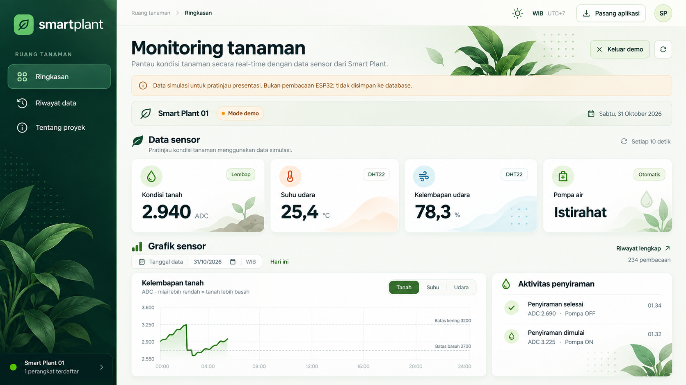
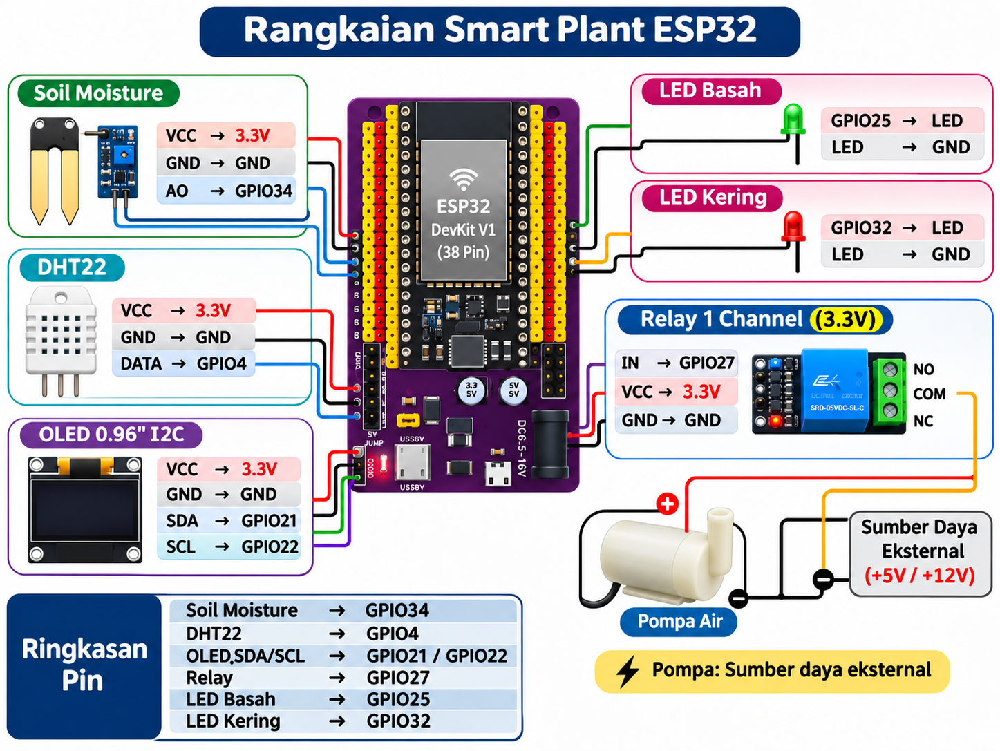

# Smart Plant

Smart Plant adalah proyek perkuliahan untuk memantau kondisi tanaman dan melakukan penyiraman otomatis menggunakan ESP32. Proyek ini menggabungkan perangkat IoT dengan website sebagai sarana belajar, pemaparan hasil, dan portofolio mahasiswa.



**Website:** [smartplant.web.id](https://smartplant.web.id)

## Gambaran proyek

Sensor membaca kelembapan tanah, suhu, dan kelembapan udara. ESP32 mengatur pompa secara otomatis berdasarkan kondisi tanah, lalu mengirimkan data ke website melalui Wi-Fi.

Website digunakan untuk melihat kondisi terbaru dan riwayat pengamatan. Penyiraman dikendalikan oleh ESP32, bukan tombol di website, sehingga tetap berjalan saat internet terputus.

## Fitur utama

- Pemantauan kondisi tanah, suhu, kelembapan udara, dan status pompa.
- Penyiraman otomatis berdasarkan hasil kalibrasi sensor tanah.
- Riwayat data dan aktivitas penyiraman berdasarkan tanggal.
- Grafik, tabel, serta unduhan CSV untuk laporan dan presentasi.
- Tampilan responsif untuk komputer dan ponsel, dapat dipasang sebagai PWA.
- Mode demo untuk mencoba tampilan tanpa perangkat; data simulasi selalu ditandai dan tidak disimpan ke database.
- Seluruh waktu ditampilkan dalam WIB.

## Perangkat dan teknologi

**Perangkat:** ESP32, sensor kelembapan tanah, DHT22, OLED SSD1306, relay, pompa air, dan LED indikator.



**Website:** Vite + TypeScript, Cloudflare Workers, dan database Cloudflare D1.

## Hasil kalibrasi tanah

Semakin kecil nilai ADC, semakin basah kondisi tanah. Batas berikut digunakan pada firmware sesuai hasil kalibrasi perangkat proyek ini.

| Kondisi | Nilai ADC |
| --- | --- |
| Basah | 0–1100 |
| Lembap | 1101–3199 |
| Kering | 3200–4095 |

Nilai **1100 termasuk basah**, sedangkan **3200 termasuk kering**, sehingga tidak ada kategori yang tumpang tindih. Hasil kalibrasi dapat berbeda pada sensor atau media tanam lain.

### Cara kerja penyiraman

1. Pompa mulai menyiram saat tanah kering, yaitu ADC **≥3200**.
2. Saat tanah menjadi lembap, pompa yang sudah menyala tetap menyiram.
3. Pompa berhenti saat tanah mencapai kondisi basah, yaitu ADC **≤1100**.
4. Jika pompa sejak awal mati dan tanah masih lembap, pompa tetap mati.

Pengaman mematikan pompa setelah terdeteksi menyala selama 60 detik dan menguncinya sampai ESP32 direset. Periksa air, sensor, dan pompa sebelum melakukan reset. Proses koneksi internet dapat menunda pemeriksaan pengaman; batas tersebut bukan jaminan waktu fisik presisi.

## Menggunakan perangkat

Firmware utama berada di [`firmware/smartplant/smartplant.ino`](firmware/smartplant/smartplant.ino). Kode dan konfigurasi cukup dalam satu file, tanpa file secret terpisah.

1. Buka sketch di Arduino IDE, lalu instal board ESP32 dan library **Adafruit SSD1306**, **Adafruit GFX Library**, serta **DHT sensor library** berikut dependensinya.
2. Isi nama Wi-Fi (`ssid`), kata sandi (`pass`), dan `DEVICE_TOKEN` yang sesuai dengan API website. Alamat API sudah menggunakan domain proyek.
3. Pilih board serta port ESP32, lalu upload. Gunakan Serial Monitor **115200** untuk melihat pembacaan dan hasil pengiriman.

| Komponen | Pin ESP32 |
| --- | --- |
| Sensor tanah | GPIO34 |
| DHT22 | GPIO4 |
| Relay pompa, aktif LOW | GPIO27 |
| LED basah | GPIO25 |
| LED kering | GPIO32 |
| OLED SDA / SCL | GPIO21 / GPIO22 |

Data terbaru dikirim setiap 10 detik. Website menyimpan satu pembacaan per menit serta perubahan status pompa yang diterima server. Data selama koneksi terputus tidak dikirim ulang.

Referensi versi Blynk tersedia terpisah di [`firmware/smartplant_wifi_blynk/`](firmware/smartplant_wifi_blynk/).

## Menjalankan website secara lokal

Siapkan Node.js 22.12+ atau 24+ dan Wrangler 4, lalu jalankan:

```sh
npm install
npm run types
npm run db:local
npm run dev
```

Buka alamat yang ditampilkan terminal, biasanya `http://127.0.0.1:5173`. Gunakan **Lihat demo** untuk mencoba grafik, riwayat, dan ekspor CSV tanpa ESP32.

Pengujian dan build:

```sh
npm test
npm run build
```

Untuk menerima data perangkat secara lokal, isi `DEVICE_TOKEN` melalui `.dev.vars` mengikuti `.dev.vars.example`. Deployment ke akun Cloudflare lain memerlukan database D1 dan token perangkat milik sendiri.

## Catatan proyek

- Gunakan catu daya yang sesuai untuk relay dan pompa. Jangan menghubungkan pompa langsung ke GPIO ESP32.
- Firmware demo belum memverifikasi identitas server HTTPS. Jangan gunakan pengaturan ini sebagai acuan keamanan untuk sistem produksi.
- Sebelum mengunggah ke GitHub, ganti token dan kata sandi dengan placeholder, termasuk pada referensi Blynk dan file lama. Cabut atau rotasi kredensial yang pernah terunggah.
